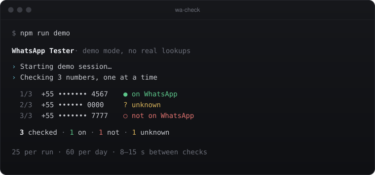

# WhatsApp Tester

Check whether a phone number has a WhatsApp account. One number at a time, at a slow pace, using **your own** WhatsApp Web session in a visible browser window.

<p align="center"></p>

Try it offline, no WhatsApp needed: `npm run demo`.

## How it works

1. Opens a real Chromium window (Playwright) with a persistent profile in `.wa-session/`. You scan the QR code once; the session stays on your machine and is git-ignored.
2. For each number it opens `web.whatsapp.com/send?phone=<number>` and waits for one of two outcomes:
   - the chat composer appears → **on WhatsApp**
   - the "phone number shared via url is invalid" dialog appears → **not on WhatsApp**
3. Anything else (timeout, logout, UI change) is reported as **unknown**, never guessed.
4. Each result is appended to `results.csv` immediately, so Ctrl+C or a crash keeps what was already checked.

Terminal output masks numbers (`+55 ••••••• 4567`). The CSV keeps the full number because it is your local file.

## Setup

Requires Node.js 20+.

```bash
git clone https://github.com/gaacarmo/whatsapp_tester.git
cd whatsapp_tester
npm install          # also downloads Chromium for Playwright
```

```bash
npm run check -- "+55 41 99999-8888"
npm run check -- --file numbers.txt --out results.csv
npm run check -- --help
```

Numbers without a country code use `--country` (default `BR`). Invalid entries are skipped with a reason; duplicates are removed.

## Limits

This is a spot-check tool, not a bulk validator. The ceilings are hard-coded; environment variables can only make them stricter.

| Limit | Default | Env var |
|---|---|---|
| Numbers per run | 25 | `WA_MAX_PER_RUN` |
| Checks per rolling 24h | 60 | `WA_MAX_PER_DAY` |
| Pause between checks | 8–15 s | `WA_MIN_GAP_MS` |

The 24h counter lives in `.wa-state/usage.json` and stores timestamps only.

## Responsible use

- Only check numbers you have a legitimate reason to check: your own contacts, your own customers who gave you their number.
- Automating WhatsApp Web may break [WhatsApp's Terms of Service](https://www.whatsapp.com/legal/terms-of-service) and can get the account that runs it restricted. Use a number you are willing to risk.
- Phone numbers are personal data (LGPD / GDPR). Keep input and result files private; they are git-ignored by default.
- Do not use this to build lead lists, scrape, or contact people who did not agree to it.

## Why there is no hosted version

Each check needs a logged-in WhatsApp account, and running it as a public web service would mean lending that account to strangers, against WhatsApp's Terms. So this stays a local tool by design: `npm run demo` shows the full flow offline, and the real thing runs on your machine with your session.

## Development

```bash
npm test     # node:test, no network, no browser
```

```
src/
  cli.js         argument parsing, limits, output
  phone.js       validation and normalization (libphonenumber-js)
  rate-limit.js  hard ceilings and the rolling 24h ledger
  detect.js      page state → verdict (pure, unit tested)
  whatsapp.js    Playwright session + offline demo stand-in
  results.js     incremental CSV writer
```

## Em português

Ferramenta local que verifica, um número por vez e com pausas, se um telefone tem WhatsApp, usando a sua própria sessão do WhatsApp Web. Limite de 25 números por execução e 60 por dia. Use só com números que você tem motivo legítimo para checar.

## License

MIT © Gabriel Carmo
